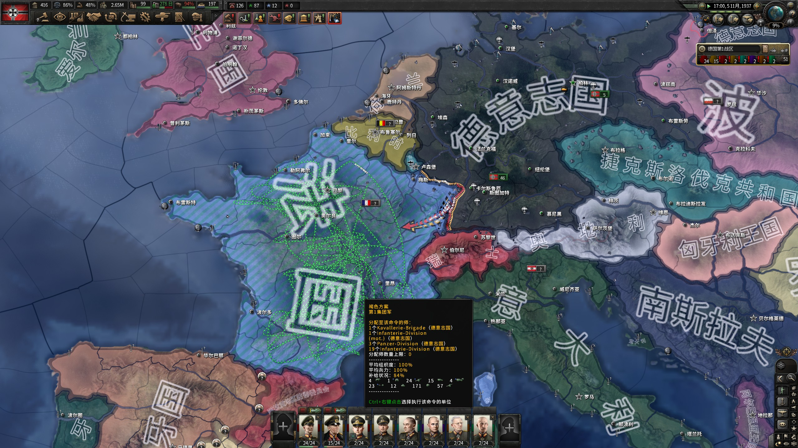
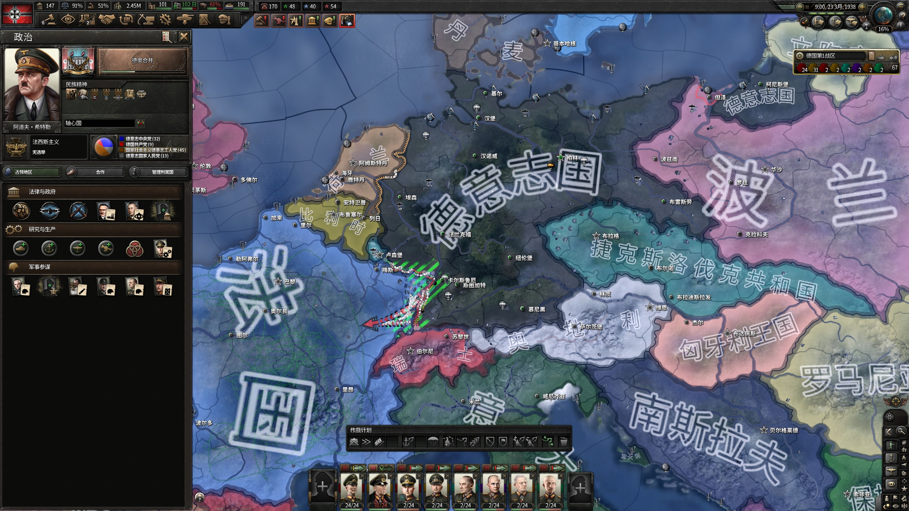
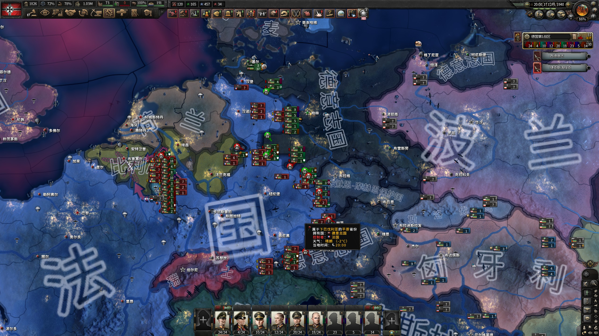

# SiliconOKW — Hearts of Iron IV (1.19.5.0) Windows 原生 MCP 自动化工具集

<p align="center">
  <b>简体中文</b> · <a href="README_EN.md">English</a>
</p>

> [!IMPORTANT]
> **项目说明**
> - 本仓库大部分代码靠**自然语言编程**完成。
> - 目前**只实际测试过德国 1936 开局**，整体完成度还相当低。
> - 如有发现工具 Bug 或特定游戏版本的内存偏移量错误，**欢迎提交 Issue 与 PR**，会尽量修复。

<p align="center">
  <b>面向 Windows x64 <code>Hearts of Iron IV 1.19.5.0</code> 的原生内存观测与合规指令自动化平台</b><br>
  <sub>Win32 纯只读实时采集 · 引擎原生 <code>CCommandQueue</code> 合规发令 · 双模式 MCP（Full 177 工具 / Compact 5 工具）</sub>
</p>

<p align="center">
  
  
  
  
  
</p>

---

## 1. 项目简介

**SiliconOKW**（硅基最高统帅部）是一套面向 **Windows Steam 版《钢铁雄心 IV》`1.19.5.0`（`Operation Postern v1.19.5.0.7c6c`）** 的 MCP 自动化与内存调用工具集。

本项目通过 **Win32 `ReadProcessMemory` 零停表纯只读采集** 与 **游戏原生 `CCommandQueue` 玩家命令队列发令**，让大模型像真实玩家一样读取战局并发出合规指令：

- **非作弊路径**：所有操作均构造游戏原生 `CCommand` 并通过引擎自身的 `CanExecute` 校验，禁用控制台与键鼠画面点击注入。
- **双模式 MCP 服务端**：支持 **Full 模式（177 个细粒度工具）** 与 **Compact 5 工具极简模式（Schema < 1k tokens）**，零第三方 MCP SDK 依赖。
- **可选 Rust 原生加速**：内置 `native/hoi4_fastmem`（PyO3 + Rayon 多核 Win32 内存扫描），缺失时自动无缝回落纯 Python/numpy 路径。

---

## 2. 实测展示

> **测试配置**
> - **测试模型**：`DeepSeek V4.1 Flash-High`
> - **运行模式**：Compact **5 工具模式**（`python clausewitz.py serve --compact`）
> - **规则约束**：**原版游戏 · 禁用控制台工具 · 禁用鼠标/键盘画面注入**（全部读写走纯内存观测 + 原生命令队列）

### 实机截图

**① 1937.01.05 · 原生作战计划与集团军编组**


**② 1938.03.23 · 内政法案、顾问/参谋自动配置与德奥合并**


**③ 1940.12.17 · 请输入文本。**


> [!WARNING]
> **补**：永远不要指望现在大模型的游玩和运营水平，你根本无法想象到它们玩这种运营游戏会有多蠢。光靠提示词是根本压不住的，只能代码强制兜底。

> [!TIP]
> **关于初衷与后续计划**
> 这套工具也是可以控制非玩家视角的其他 tag 的，理论上能实现双 Agent 德苏互相喂饭。一开始的想法其实就是想让大肥鱼陪我玩钢丝，不过现在只能先暂缓开发进度了，或者等什么时候有更强、更便宜且幻觉率低的模型出来；后续也可能会尝试优化并重构一下石山代码 😄

---

## 3. 还没做的功能

以下模块目前尚未实现或仅覆盖部分能力，欢迎 PR 补齐：

- **训练部队**（完整新兵训练队列与自动化扩军编排）
- **情报机构**（创建、升级、特工招募与情报行动）
- **实验设施**（特别工程项目 / 设施建设与科研）
- **外交选项（部分）**（目前重点覆盖了宣战、造借口、贸易等核心路径，通用多态外交动作尚未全量封装）

---

## 4. 核心架构

```text
┌──────────────────────────────────────────────────────────────────────┐
│  MCP Client (Claude Code / Claude Desktop / Cursor / Custom Agent)  │
└─────────────────────────────────┬────────────────────────────────────┘
                                  │ JSON-RPC 2.0 over stdio
┌─────────────────────────────────▼────────────────────────────────────┐
│  clausewitz.py / mcp/server.py                                       │
│    • Full 模式：177 个细粒度 hoi4_* 工具                              │
│    • Compact 模式：5 工具 + turnengine（简报 / Plan DSL / 红点门禁）   │
└──────────────────┬───────────────────────────────┬───────────────────┘
                   │ 纯只读观测                     │ 原生命令队列发令
┌──────────────────▼────────────────┐ ┌────────────▼───────────────────┐
│  calling/ (核心调用层)             │ │  calling/cmdwin.py & winject   │
│    • mem.py / fastmem.py (Rust)   │ │    • 原生 ctor + CanExecute    │
│    • game.py / offsets_win.py     │ │    • fake_vtable 防跨堆释放     │
│    • armyops_win / airops_win     │ │    • post_drained 回读核验      │
│    • navalops_win / trade_win     │ │                                │
│    • events_win / peacewin        │ │                                │
│    • combat / movemicro / frontd  │ │                                │
│    • macros / housekeep / reddots │ │                                │
└──────────────────┬────────────────┘ └────────────┬───────────────────┘
                   │ ReadProcessMemory              │ CCommandQueue::Post
┌──────────────────▼───────────────────────────────▼───────────────────┐
│  hoi4.exe  (Hearts of Iron IV 1.19.5.0 Windows x64 PE)              │
└──────────────────────────────────────────────────────────────────────┘
```

### 已实现的兜底与工程护栏
- **代码级运营兜底**：内置红点门禁（`reddots`）、`housekeep` 常规管家、`rebalance_production` 产能配平、`upgrade_template_preset` 换编挪厂联动与 `strategic_health` 战略体检，防止模型空转或摆烂。
- **战斗计划与安全防崩**：支持原生 `CompletePlan` / `COrderNewFrontCommand`（`0xD57D90` 敌对连通区匹配）、单条/整军转守（`hoi4_execute_plan(executing=false)`）、按敌国隔离前线（不抽调马奇诺驻防军）、`hoi4_move_divisions(spread=true)` 自动分散撤军、0 师空订单清理（防 `0xB2E62E` 崩溃）与跨堆释放防护（`fake_vtable`）。

---

## 5. 快速开始

详细安装与排障请参见 [INSTALL.md](INSTALL.md)。

### 1) 环境要求
- Windows 10 / 11 x64
- Python 3.11+
- Steam 版 Hearts of Iron IV **`1.19.5.0`**（进程名 `hoi4.exe`）
- 与游戏运行在同一 Windows 用户权限级别（同级无需管理员）

### 2) 安装依赖与自检

```powershell
python -m pip install -r requirements.txt

# 游戏未安装在默认 Steam 目录时指定环境变量
$env:HOI4_PATH = "D:\SteamLibrary\steamapps\common\Hearts of Iron IV"

# 环境自检
python clausewitz.py doctor

# 游戏读档后纯只读查看当前战局
python clausewitz.py status
```

### 3) 挂载到 MCP 客户端

- **Compact 5 工具极简模式（推荐用于长局运营）**：
  ```powershell
  claude mcp add hoi4 -- python "D:\path\to\SiliconOKW\clausewitz.py" serve --compact
  ```
- **Full 177 工具全量模式**：
  ```powershell
  claude mcp add hoi4 -- python "D:\path\to\SiliconOKW\clausewitz.py" serve
  ```
- 更多 JSON 配置模板见 [mcp/config/](mcp/config/)。

### 4) 可选：构建 Rust 内存扫描加速扩展

```powershell
powershell -File native/hoi4_fastmem/build_win.ps1
```

不编译也能运行，`calling/fastmem.py` 会自动回落到纯 Python/numpy 路径。

---

## 6. 目录结构

| 路径 | 说明 |
|---|---|
| `clausewitz.py` | 统一入口：`serve`（`--compact`）、`doctor`、`status`、`brief`、`tools`、`tables`、`shell` |
| `calling/` | 核心内存读写、游戏对象模型、PE `1.19.5.0` 偏移表 `offsets_win.py`、命令表与运营兜底模块 |
| `mcp/` | 零依赖 stdio MCP 服务端 `server.py` 与 Windows 客户端配置模板 |
| `native/` | `hoi4_fastmem`（Rust Win32 扫描扩展）与 `hoi4_recalc`（PE 偏移校验工具） |
| `research/` | PE `1.19.5.0` 反汇编参考笔记 `WINDOWS_1.19.5.md`、离线反汇编工具链与回归测试 `research/windows/test_*.py` |
| `docs/` | 策略参考提示词 `STRATEGY_PROMPT.md` 与定点数/动态变量说明 |
| `tools/` | 独立分发压缩包构建脚本 `build_bundle.py` |

---

## 7. 离线回归测试

无需启动游戏即可运行全套 22 组离线回归测试（提交 PR 前建议先跑一遍）：

```powershell
python -c "import pathlib, subprocess, sys; ts=sorted(pathlib.Path('research/windows').glob('test_*.py')); rs=[(t.name, subprocess.run([sys.executable, str(t)]).returncode) for t in ts]; print(f'PASS {sum(r==0 for _,r in rs)}/{len(rs)}'); sys.exit(any(r!=0 for _,r in rs))"
```

---

## 8. 许可协议与免责声明

- 本项目采用 [MIT License](LICENSE) 开源。欢迎通过 Issue 反馈 Bug 或特定版本偏移问题，欢迎 PR 补全尚未实现的功能模块。
- **免责声明**：本项目仅用于**单机模式下的 AI 自动化研究与技术交流**，不包含《钢铁雄心 IV》游戏本体、DLC 解锁工具或任何受版权保护的游戏原始资源；严禁用于多人联机作弊或任何违反游戏服务条款的用途。使用本项目涉及进程内存读写，请提前备份存档并自行承担相应风险。
