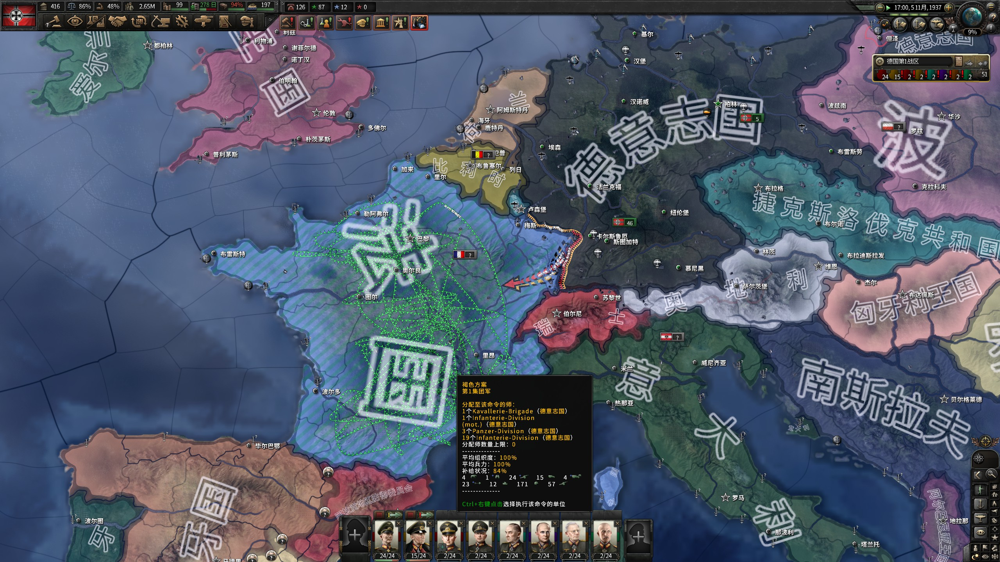
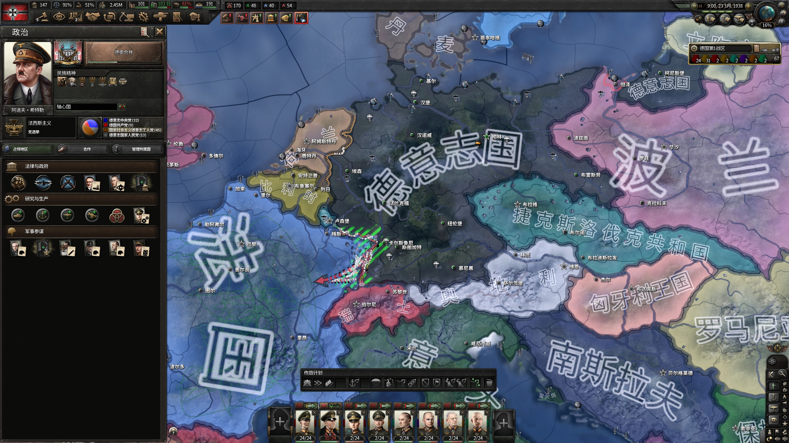
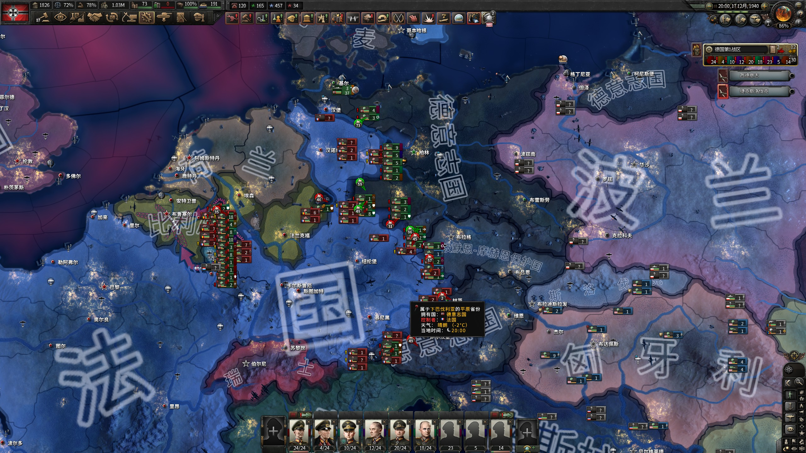

# SiliconOKW — Native Windows MCP Automation Toolkit for Hearts of Iron IV (1.19.5.0)

<p align="center">
  <a href="README.md">简体中文</a> · <b>English</b>
</p>

> [!IMPORTANT]
> **Project Status & Disclaimer**
> - Most of the code in this repository was written via **vibe coding**.
> - So far it has **only been playtested on the Germany 1936 start**, and overall completeness is still quite low.
> - If you run into tool bugs or memory offset mismatches on a specific game build, **Issues and PRs are very welcome** — I will try my best to fix them.

<p align="center">
  <b>Native memory observation & legitimate command-queue automation for Windows x64 <code>Hearts of Iron IV 1.19.5.0</code></b><br>
  <sub>Zero-pause Win32 read-only inspection · Native <code>CCommandQueue</code> player commands · Dual-mode MCP (Full 174 play tools / Compact 5 tools)</sub>
</p>

<p align="center">
  
  
  
  
  
</p>

---

## 1. Overview

**SiliconOKW** is an MCP automation and reverse-engineering toolkit built for the **Windows Steam build of Hearts of Iron IV `1.19.5.0` (`Operation Postern v1.19.5.0.7c6c`)**.

Using **zero-pause Win32 `ReadProcessMemory` inspection** and the game's own **`CCommandQueue` player command channel**, it lets LLMs read live war state and issue legitimate player actions:

- **Not a cheat tool**: Every action constructs a genuine engine `CCommand` subclass and passes through the game's own `CanExecute` validation — no console commands, no raw memory value edits, and no mouse/keyboard UI click injection.
- **Dual-mode stdio MCP server**: Supports both **Full mode (174 granular play tools; `hoi4_debug_*` disabled by default)** and **Compact 5-tool mode (schema < 1k tokens)** with zero third-party MCP SDK dependencies.
- **Optional Rust native acceleration**: Includes `native/hoi4_fastmem` (PyO3 + Rayon multi-threaded Win32 memory scanner) with seamless fallback to pure Python/numpy when absent.

---

## 2. Live Playtest Showcase

> **Test Setup**
> - **Model**: `DeepSeek V4.1 Flash-High`
> - **Mode**: Compact **5-tool mode** (`python clausewitz.py serve --compact`)
> - **Constraints**: **Vanilla game · Console tools disabled · Mouse/keyboard injection disabled** (strictly memory reads + native command queue)

### Screenshots

**1) 1937-01-05 · Native Battle Plans & Army Organization**


**2) 1938-03-23 · Automated Politics, Advisors/High Command & Anschluss**


**3) 1940-12-17 · [Insert text here.]**


> [!WARNING]
> **Note**: You're better off not expecting current LLMs to actually play or macro well — you genuinely cannot imagine how dumb they can be at grand-strategy resource/front management. Prompts alone cannot keep them in line; hard-coded guardrails and fallbacks in code are the only way.

> [!TIP]
> **Original Motivation & Roadmap**
> This toolkit can control **non-player country tags** as well, meaning in theory it can run **dual-Agent Germany vs. USSR** campaigns feeding off each other (my original goal was simply to let DeepSeek play HOI4 alongside me as a co-op/opponent buddy). For now, active development is paused while waiting for stronger, cheaper models with lower hallucination rates — though I may come back later to optimize and refactor this mountain of spaghetti code 😄

---

## 3. Not Implemented Yet

The following systems are not yet implemented or only partially covered — PRs welcome:

- **Unit Training** (full recruitment queue & automated division deployment pipeline)
- **Intelligence Agency** (agency creation, upgrades, operatives & espionage operations)
- **Experimental Facilities** (special projects & facility construction/research)
- **Diplomatic Actions (partial)** (core flows like war justification, war declaration and trade are wired; generic polymorphic diplomatic actions are not fully wrapped yet)

---

## 4. Architecture

```text
┌──────────────────────────────────────────────────────────────────────┐
│  MCP Client (Claude Code / Claude Desktop / Cursor / Custom Agent)  │
└─────────────────────────────────┬────────────────────────────────────┘
                                  │ JSON-RPC 2.0 over stdio
┌─────────────────────────────────▼────────────────────────────────────┐
│  clausewitz.py / mcp/server.py                                       │
│    • Full mode:    174 granular play hoi4_* tools                    │
│    • Compact mode: 5 tools + turnengine (brief / Plan DSL / guard)   │
└──────────────────┬───────────────────────────────┬───────────────────┘
                   │ Pure read-only inspection     │ Native command queue
┌──────────────────▼────────────────┐ ┌────────────▼───────────────────┐
│  calling/ (Core Call Layer)       │ │  calling/cmdwin.py & winject   │
│    • mem.py / fastmem.py (Rust)   │ │    • Native ctor + CanExecute  │
│    • game.py / offsets_win.py     │ │    • fake_vtable CRT guard     │
│    • armyops_win / airops_win     │ │    • post_drained verification │
│    • navalops_win / trade_win     │ │                                │
│    • events_win / peacewin        │ │                                │
│    • combat / movemicro / frontd  │ │                                │
│    • macros / housekeep / reddots │ │                                │
└──────────────────┬────────────────┘ └────────────┬───────────────────┘
                   │ ReadProcessMemory              │ CCommandQueue::Post
┌──────────────────▼───────────────────────────────▼───────────────────┐
│  hoi4.exe  (Hearts of Iron IV 1.19.5.0 Windows x64 PE)              │
└──────────────────────────────────────────────────────────────────────┘
```

### Code-Enforced Guardrails & Safety Nets
- **Anti-blunder macro guardrails**: Alert/red-dot gates (`reddots`), automated `housekeep`, `rebalance_production`, `upgrade_template_preset` (template edit + factory reallocation), and `strategic_health` diagnostics to stop LLMs from idling or sabotaging their economy.
- **Battle-plan & crash protection**: Native `CompletePlan` / `COrderNewFrontCommand` (`0xD57D90` connected enemy-area matching), single-arrow or whole-army halt (`hoi4_execute_plan(executing=false)`), per-enemy front isolation, `hoi4_move_divisions(spread=true)` BFS anti-stacking retreat, zero-division order cleanup (preventing `0xB2E62E` crashes), and `fake_vtable` cross-heap CRT free protection.

---

## 5. Quick Start

See [INSTALL.md](INSTALL.md) for detailed setup & troubleshooting (in Chinese).

### 1) Requirements
- Windows 10 / 11 x64
- Python 3.11+
- Steam version of Hearts of Iron IV **`1.19.5.0`** (`hoi4.exe`)
- Run the MCP server under the **same Windows integrity level** as the game (no admin required if neither is elevated)

### 2) Install & Check

```powershell
python -m pip install -r requirements.txt

# Set HOI4_PATH if the game is installed outside standard Steam libraries
$env:HOI4_PATH = "D:\SteamLibrary\steamapps\common\Hearts of Iron IV"

# Environment check
python clausewitz.py doctor

# Pure read-only status summary (after loading a save in-game)
python clausewitz.py status
```

### 3) Attach to an MCP Client

- **Compact 5-tool mode (recommended for campaigns)**:
  ```powershell
  claude mcp add hoi4 -- python "D:\path\to\SiliconOKW\clausewitz.py" serve --compact
  ```
- **Full 174-tool mode** (all `hoi4_debug_*` cheat/debug tools are disabled and hidden by default; set `HOI4_MCP_ALLOW_DEBUG=1` for local RE debugging, and `hoi4_debug_eval` additionally requires `HOI4_MCP_ALLOW_EVAL=1`):
  ```powershell
  claude mcp add hoi4 -- python "D:\path\to\SiliconOKW\clausewitz.py" serve
  ```
- More JSON templates are available in [mcp/config/](mcp/config/).

### 4) Optional: Build the Rust Memory Scanner Extension

```powershell
powershell -File native/hoi4_fastmem/build_win.ps1
```

Precompiled `calling/hoi4_fastmem.pyd` is bundled in GitHub Releases; without it, `calling/fastmem.py` automatically falls back to pure Python/numpy.

### 5) Must-Read Before Using

1. **Keep the game window unminimized**: Minimizing HOI4 freezes the simulation clock and makes D3D thread suspend/resume risky; check window status before issuing commands.
2. **Purge empty orders after loading a save**: Run `hoi4_purge_orders` after loading a save and before unpausing to clear leftover 0-division orders (prevents `0xB2E62E` crashes).
3. **Send write commands serially and verify by reading back**: A `-32001` timeout does not necessarily mean the command failed — verify live state with a read-only tool before retrying.
4. **Stop background front micro before reloading or switching saves**: Call `hoi4_clear_front_directive()` first and confirm `frontd` is `idle`.

---

## 6. Repository Layout

| Path | Description |
|---|---|
| `clausewitz.py` | Unified CLI entry point: `serve` (`--compact`), `doctor`, `status`, `brief`, `tools`, `tables`, `shell` |
| `calling/` | Core Win32 memory layer, game object model, PE `1.19.5.0` offsets (`offsets_win.py`), command tables & guardrails |
| `mcp/` | Zero-dependency stdio MCP server (`server.py`) and Windows client config templates |
| `native/` | `hoi4_fastmem` (Rust Win32 parallel scanner) and `hoi4_recalc` (PE offset verifier) |
| `research/` | PE `1.19.5.0` disassembly notes (`WINDOWS_1.19.5.md`), offline RE helpers & regression tests (`research/windows/test_*.py`) |
| `docs/` | Strategy prompt reference (`STRATEGY_PROMPT.md`) and fixed-point / dynamic variable notes |
| `tools/` | Standalone release bundle builder (`build_bundle.py`) |

---

## 7. Offline Regression Tests

Run the offline test suite on Windows without launching the game (2 tests require local `hoi4_recalc.exe` / first-run `techids.pkl` caches):

```powershell
python -c "import pathlib, subprocess, sys; ts=sorted(pathlib.Path('research/windows').glob('test_*.py')); rs=[(t.name, subprocess.run([sys.executable, str(t)]).returncode) for t in ts]; print(f'PASS {sum(r==0 for _,r in rs)}/{len(rs)}'); sys.exit(any(r!=0 for _,r in rs))"
```

---

## 8. License & Disclaimer

- Released under the [MIT License](LICENSE). Issues for bugs / build-specific offsets and PRs for missing features are warmly welcome.
- **Security Note**: All `hoi4_debug_*` tools are disabled by default (`hoi4_debug_eval` requires both `HOI4_MCP_ALLOW_DEBUG=1` and `HOI4_MCP_ALLOW_EVAL=1`). Pre-generated `*.pkl` cache files included in the repository are offline indexes derived from game files; if you prefer not to load prebuilt pickles, delete them and let the toolkit rebuild them from your local HOI4 installation.
- **Disclaimer**: This project is intended strictly for **single-player AI automation research and educational purposes**. It does not include any Hearts of Iron IV game binaries, DLC unlockers, or copyrighted game assets, and must **never** be used for multiplayer cheating or any violation of the game's Terms of Service. Because it interacts with live process memory, please back up your saves and use at your own risk.
